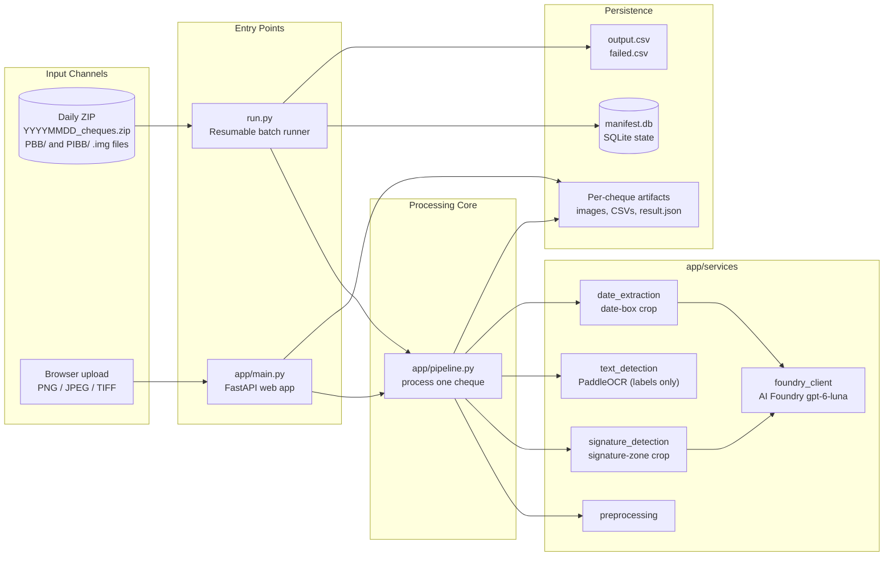
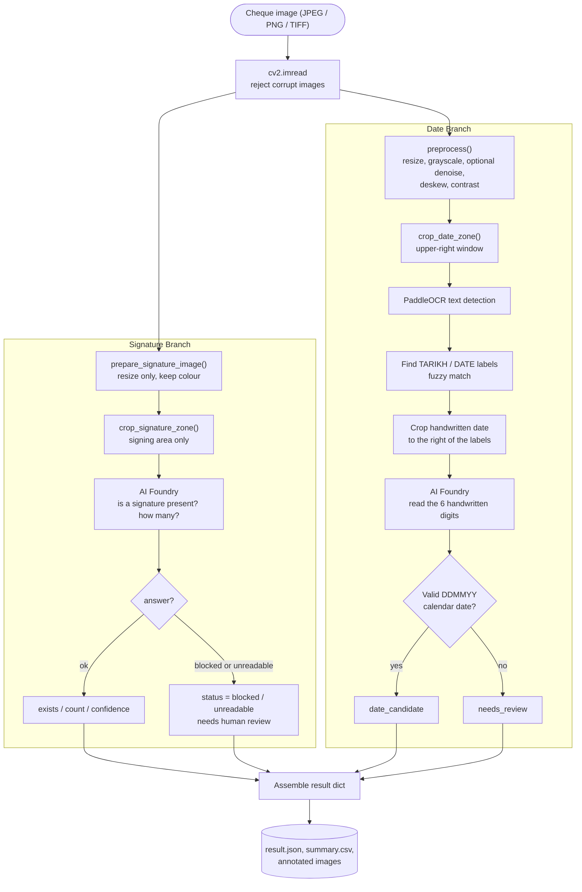
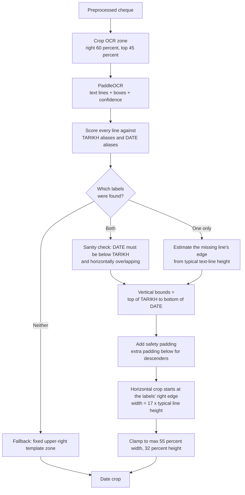
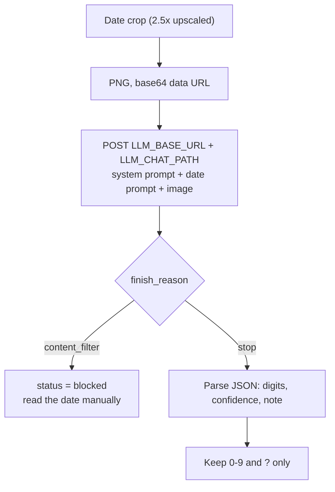
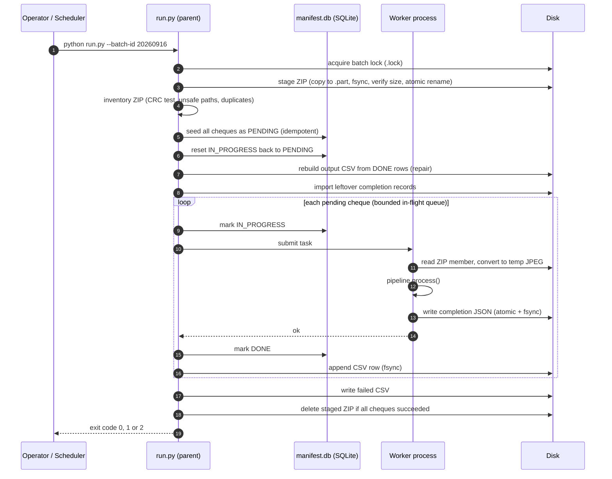
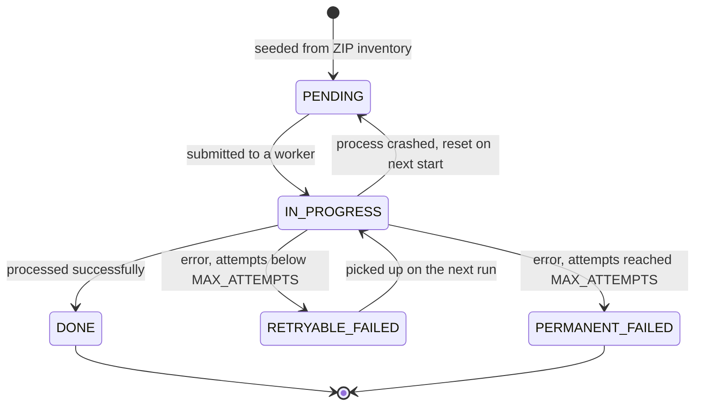
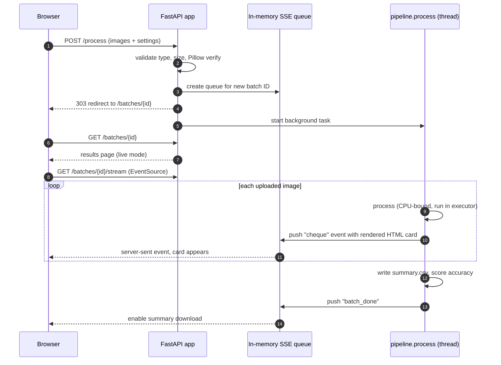
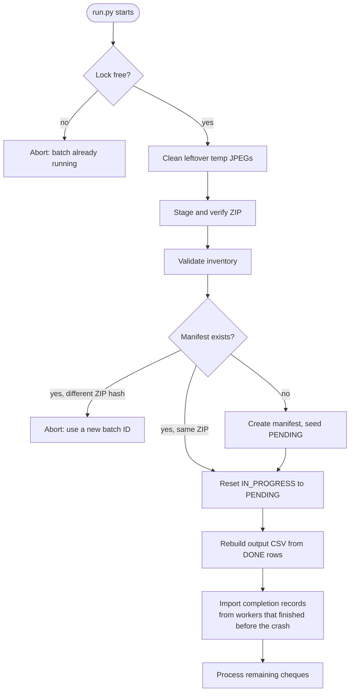

# Cheque Processing Platform

An auditable, crash-resilient cheque analysis pipeline built with **FastAPI**, **PaddleOCR**, and **AI Foundry** (`gpt-6-luna`). For every cheque image the system answers two questions: *is there a signature?* and *what handwritten date is written on it?* Only two small crops of each cheque are sent to AI Foundry (the signing area and the date boxes), never the full cheque. It ships with two ways to run: a **web UI** for interactive review, and a **resumable ZIP batch runner** for high-volume daily processing (~20,000 cheques per batch), backed by a SQLite manifest so that no cheque is ever lost or processed twice, even after a crash.

---

## 📑 Table of Contents

- [Overview & Architecture](#-overview--architecture)
- [Key Features](#-key-features)
- [Extracted Entities](#-extracted-entities)
- [How a Single Cheque Is Processed](#-how-a-single-cheque-is-processed)
- [Batch Mode: Resumable ZIP Processing](#-batch-mode-resumable-zip-processing)
- [Web Mode: Live Review UI](#-web-mode-live-review-ui)
- [System Requirements](#-system-requirements)
- [Installation & Setup](#-installation--setup)
- [Configuration (.env)](#-configuration-env)
- [Running the Application](#-running-the-application)
- [Web Routes Reference](#-web-routes-reference)
- [Output Reference](#-output-reference)
- [Accuracy Scoring](#-accuracy-scoring)
- [Directory Structure & Storage Layout](#-directory-structure--storage-layout)
- [Performance & Worker Tuning](#-performance--worker-tuning)
- [Failure Handling & Resiliency](#-failure-handling--resiliency)
- [Security Notes](#-security-notes)
- [Known Limitations](#-known-limitations)
- [Troubleshooting](#-troubleshooting)

---

## 🏗 Overview & Architecture

The project has **one processing core** (`app/pipeline.py`) and **two front doors** that feed it. Both entry points call the same `process()` function, so a cheque produces identical results whether it came from the browser or from the nightly ZIP.



### Two modes at a glance

| | **Batch mode** (`run.py`) | **Web mode** (`app/main.py`) |
| :--- | :--- | :--- |
| **Purpose** | Production volume, unattended, daily | Interactive review, tuning, demos |
| **Input** | `YYYYMMDD_cheques.zip` of `.img` files | PNG / JPEG / TIFF uploads (multi-file) |
| **Concurrency** | Multi-process worker pool | One cheque at a time in a background task |
| **State** | SQLite manifest (durable, resumable) | In-memory event queue (live view only) |
| **Output** | `<batch>_output.csv` + `<batch>_failed.csv` | Live result cards + `summary.csv` |
| **Accuracy scoring** | No | Yes (against `ground_truth.csv`) |

---

## ✨ Key Features

- **Two-signal analysis per cheque**: signature presence and handwritten-date reading by AI Foundry, each from its own small crop and reported with a confidence level.
- **Crops only, never the full cheque**: the signature check sees only the signing area and the date reading sees only the date boxes, so names, amounts and account numbers are not sent. See [AI Foundry prompts and guardrails](#ai-foundry-prompts-and-guardrails).
- **Layout-anchored date reading**: instead of trusting a fixed pixel position, the system uses PaddleOCR to find the printed **TARIKH / DATE** labels and crops the handwritten date relative to them. This makes it robust to different scan sizes and small template shifts.
- **Fuzzy label matching**: tolerates common OCR misreads (`TARlKH`, `D4TE`, `DATF`, …) and can reconstruct the crop from a single found label when the other is unreadable.
- **Calendar validation**: the six digits (`DDMMYY`) are checked against the real calendar (including leap years) and flagged `date_candidate` or `needs_review`.
- **Resumable batch processing**: a SQLite manifest tracks every cheque's state. Kill the process at any moment and a re-run resumes exactly where it stopped.
- **Durable, exactly-once output**: a per-cheque completion record is written and fsynced *before* the parent acknowledges it, and the output CSV is rebuilt on startup to repair any half-written row.
- **Safe ZIP ingestion**: CRC validation, path-traversal rejection, duplicate detection, atomic staging copy, and streaming reads (the ZIP is never bulk-extracted to disk).
- **Auto-sized worker pool**: worker count derived from CPU cores, with native thread pools (OpenMP / MKL / BLAS) capped per worker to prevent oversubscription.
- **Live web UI**: Server-Sent Events stream each cheque's result card to the browser the moment it finishes.
- **Built-in accuracy report**: compare results against a ground-truth CSV and get per-cheque and aggregate signature / digit accuracy.
- **Full audit trail**: the exact crops sent to AI Foundry, each model reply (`llm_response.json`), annotated images, and a complete `result.json` for every cheque (optional, toggled by `SAVE_ARTIFACTS`).
- **Guardrail-aware**: a request the platform guardrail blocks is marked for review (`REVIEW` / `blocked`), never silently reported as "no signature", and never retried.

---

## 🎯 Extracted Entities

| Field | Description |
| :--- | :--- |
| `signature_detected` | `YES` / `NO`, or `REVIEW` (batch CSV) when AI Foundry gave no usable answer. |
| `signature_count` | Number of separate handwritten signatures the model saw (joint accounts can have 2). |
| `signature_status` | `ok`, `blocked` (platform guardrail refused the request) or `unreadable` (reply was not valid JSON). |
| `date` | Handwritten date formatted as `DD/MM/YY`. |
| `date_status` | `date_candidate` (valid calendar date), `needs_review` (invalid or uncertain reading), `no_date`, `blocked`, or `empty_crop`. |
| `raw_digits` | The digits as read, no separators, e.g. `160926`; `?` marks a digit the model could not read. |
| `date_confidence` | The model's own rating: `high`, `medium` or `low`. |
| OCR text lines | All printed text found in the date region with quadrilateral coordinates and confidence. |
| `bank_code` (batch) | `PBB` or `PIBB`, taken from the ZIP folder the cheque lives in. |

> **Signature detection is presence detection only.** The system reports *whether a signature-like region exists*, not whether it is *authentic* or matches a specimen.

> **Review-assisted by design.** Handwriting varies. Treat `needs_review` results as prompts for a human check, and use the confidence values to prioritise that review.

---

## 🔬 How a Single Cheque Is Processed

`process()` in `app/pipeline.py` runs these stages. The signature branch and the date branch are independent of each other (they share only the input image).



### Stage 1: Preprocessing (`app/services/preprocessing.py`)

The pipeline deliberately produces **two different copies** of the image, because signature detection and OCR want opposite things:

| Copy | Steps | Why |
| :--- | :--- | :--- |
| **OCR copy** (`preprocess`) | Upscale small scans (short edge below 1000 px, up to 4×) → cap the long edge (`PREPROCESS_MAX_LONG_EDGE`, default 3000) → grayscale → optional denoise → deskew (only if the angle is within ±8°, otherwise ignored as unreliable) → contrast boost | Clean, high-contrast text is easier for OCR and for reading the date digits. |
| **Signature copy** (`prepare_signature_image`) | Resize only, **colour preserved**, long edge capped at `SIGNATURE_MAX_LONG_EDGE` (1600) | Denoise / contrast / deskew can erase light pen strokes, so the signature crop is cut from an untouched colour copy. |

The original image is never modified.

### Stage 2: Signature check (`app/services/signature_detection.py`)

1. The resized colour image is cropped to the **signing area** (default: right 70% of the width, from 55% to 87% of the height). This crop is the only part of the cheque sent for the signature check. The bottom edge stops above the MICR line so the cheque and account numbers are not sent; check `signature/annotated.png` to see the zone on your own scans and tune `SIGNATURE_ZONE_*` if needed.
2. AI Foundry is asked whether the crop contains a handwritten signature and how many (see [the prompts](#ai-foundry-prompts-and-guardrails)). It is told not to describe or copy the signature.
3. The reply is parsed into `exists`, `count` and `confidence` (`high` / `medium` / `low`). Presence and count are kept consistent (present with count 0 becomes 1; absent forces 0).
4. If the guardrail blocks the request or the reply is not valid JSON, `status` is `blocked` / `unreadable` and the batch CSV says `REVIEW`, so a cheque nobody checked is never reported as `NO`.

### Stage 3: Locating the date field (`app/services/text_detection.py`, `date_extraction.py`)

Cheque dates are handwritten, but the **printed labels beside them** are stable. On a Public Bank cheque, `TARIKH` sits directly above `DATE`. The system finds those labels first, then reads what is to their right.



Key ideas worth knowing:

- **Fuzzy matching.** Each OCR line is normalised (uppercase, alphanumerics only) and scored against alias lists using substring match plus `difflib` similarity (threshold 0.66). Aliases include known OCR corruptions such as `TARlKH`, `D4TE`, `DATF`. A weak `WN` token is accepted as a possible label only in the upper-right region.
- **Scale-invariant sizing.** Crop padding and width are expressed in multiples of the **median text-line height** found on the page, not in pixels, so the geometry holds when scan resolution changes.
- **Asymmetric padding.** Extra room is added *below* the labels because looped digits (a `6` or `2`) and descenders extend lower than printed text predicts.
- **Hard ceilings.** Crop size is capped as a fraction of the page as a last line of defence against a bad anchor measurement.

### Stage 4: Reading the digits (AI Foundry)

The date crop is upscaled 2.5x (so small handwriting stays legible), capped at `LLM_IMAGE_MAX_LONG_EDGE`, and sent to AI Foundry, which returns the digits left to right. PaddleOCR is used only to *locate* the date boxes; it runs locally and nothing it reads is sent.



#### AI Foundry prompts and guardrails

The prompts live in `app/services/prompts.py`. AI Foundry sits behind a platform guardrail that refuses requests to pull personal or financial details out of document images; tests showed full-cheque extraction requests were refused while a signature-presence question was allowed. The prompts are written so that every request is a narrow, visual question about a small crop:

- Each request carries **only a crop** and asks **one question** (is there a signature / which digits are in the boxes).
- Nothing asks the model to identify a person, read names or account numbers, judge authenticity, or reproduce what it sees.
- The wording describes only what is in the crop. Words such as *bank*, *cheque*, *account*, *extract*, *verify*, *fraud* add nothing the model needs and are left out.
- The signature prompt tells the model not to describe or copy the signature, keeping the answer to yes/no and a count.

A blocked request is **not** retried: if the guardrail still refuses a crop, that is the platform saying the use case needs its approval, so raise it with the platform team instead of rewording to get around it. Network errors, HTTP 429 and 5xx are retried (`LLM_MAX_ATTEMPTS`); if they persist, the cheque fails and the batch runner retries it on a later attempt.

### Stage 5: Validation and result

The digits are formatted as `DD/MM/YY` and validated as a real calendar date (`2000 + YY`, leap-year aware). `confidence` is the model's own `high` / `medium` / `low` rating; an empty reading becomes `no_date`, an invalid one `needs_review`. The final dictionary is written atomically to `result.json` (temp file + `os.replace`).

---

## 📦 Batch Mode: Resumable ZIP Processing

Batch mode is built for one job: take the day's ZIP, process every cheque in it, and produce one CSV, *reliably*, even if the machine dies halfway.

### Input contract

- File name: `YYYYMMDD_cheques.zip` (pattern configurable via `BATCH_ZIP_NAME_PATTERN`), placed in `data/incoming/`.
- Contents: `.img` files beneath a top-level `PBB/` and/or `PIBB/` folder. Non-`.img` files are ignored; an `.img` outside those folders is rejected.
- Each `.img` is decoded with Pillow, **frame zero** is used (multi-frame TIFF-style images), converted to RGB if needed, and re-encoded as a temporary JPEG (quality 95) that is deleted immediately after processing. Nothing is bulk-extracted to disk.

### End-to-end flow



### Cheque lifecycle

Every cheque is a row in the manifest's `cheques` table and moves through this state machine:



> Each run attempts every unfinished cheque **once**. A cheque that fails becomes `RETRYABLE_FAILED` and is retried the **next time `run.py` is executed**, up to `MAX_ATTEMPTS` total attempts (default 3). Wire the runner to a scheduler and use its exit code to trigger a re-run (see below).

### Why it never loses or duplicates a cheque

| Concern | Mechanism |
| :--- | :--- |
| Corrupt or hostile ZIP | `testzip()` CRC check, `..` / absolute-path rejection, duplicate-member rejection, folder-prefix enforcement |
| Half-copied ZIP | Copy to `*.part`, `fsync`, compare size to source, then atomic `os.replace` |
| Original ZIP safety | The source ZIP is **never modified**; only the staged copy is deleted after a fully successful batch |
| Wrong ZIP for a batch ID | Manifest stores the ZIP's **SHA-256 fingerprint**; a different ZIP with the same batch ID is refused |
| Changed inventory | If the ZIP's cheque list differs from the manifest, resume is refused rather than risk wrong results |
| Two runners at once | Exclusive file lock (`.lock`) per batch directory |
| Crash mid-cheque | `IN_PROGRESS` rows are reset to `PENDING` on next start and reprocessed |
| Crash between "worker finished" and "parent recorded it" | The worker writes an fsynced **completion JSON** first; on restart the runner imports any leftover completion records |
| Ambiguous last CSV row after a crash | The output CSV is **rebuilt atomically** from `DONE` rows on every start, before new rows are appended |
| Duplicate CSV rows | An `output_emitted` flag per cheque makes appends idempotent |
| One bad scan killing the batch | Each worker catches its own exceptions; failure is recorded and the batch continues |
| Memory blow-up on 20,000 cheques | Only `workers × BATCH_INFLIGHT_MULTIPLIER` tasks are ever queued at once |

### Exit codes

| Code | Meaning |
| :--- | :--- |
| `0` | Every cheque is `DONE`. |
| `1` | Some cheques are still unfinished (`PENDING` / `RETRYABLE_FAILED`). Re-run to continue. |
| `2` | Everything was attempted, but some cheques are `PERMANENT_FAILED`. See `<batch>_failed.csv`. |

---

## 🖥 Web Mode: Live Review UI

The web app accepts one or many cheque images, processes them in the background, and streams each result to the browser as soon as it is ready. Upload and results are separate pages, so a finished batch has its own permanent URL.



**Design notes**

- Processing is blocking work (OpenCV, PaddleOCR, and two AI Foundry calls), so it runs via `run_in_executor`. This keeps the event loop free to flush SSE events immediately.
- One failing image emits a `cheque_error` event and the rest of the batch continues.
- While a batch is processing it lives in memory (`_batch_queues`). Once finished, the page is rebuilt purely from the saved `result.json` files, so **results survive a server restart**.
- Upload temp files are always deleted in a `finally` block.
- The upload form exposes preprocessing options (max edge, contrast, denoise, deskew), the signature threshold, and date search width, all bounds-checked on the server.

> **Requirement:** the web UI reads annotated images and `result.json` from disk, so it needs `SAVE_ARTIFACTS=true` (the default).

---

## ⚙️ System Requirements

- **Operating System**: **Windows** for batch mode (see [Known Limitations](#-known-limitations)). The web app itself is standard Python/FastAPI.
- **Python**: 3.10 or 3.11 (PaddleOCR support is substantially better than on 3.9).
- **Hardware**: CPU only. No GPU is required or used.
- **Network**: HTTPS access from the server to AI Foundry (`LLM_BASE_URL`) and a `HELPER_ID` for it.
- **Disk**: allow for artifact output. With `SAVE_ARTIFACTS=true`, each cheque writes roughly 20 files.
- **Model files** (not included in the repository): PaddleOCR models (detection, recognition, optional angle classifier) in a shared folder. They are used only to locate the printed date labels. Signature and date reading are AI Foundry calls, so no other model files are needed.

---

## 🚀 Installation & Setup

### 1. Clone the Repository
```powershell
git clone https://github.com/heyitssyakirrr/cheque-fraud-detection.git
cd cheque-fraud-detection
```

### 2. Create and Activate a Virtual Environment
```powershell
py -3.11 -m venv .venv
.\.venv\Scripts\Activate.ps1
```

### 3. Install Dependencies
```powershell
python -m pip install --upgrade pip
pip install -r requirements.txt
```

Key pinned versions: `paddlepaddle==2.6.2`, `paddleocr==2.10.0`, `numpy<2`.

### 4. Place the PaddleOCR Model Files

```text
../FileReader/models/                       # shared PaddleOCR models (OCR_MODELS_DIR)
├── en_PP-OCRv3_det_infer/
├── en_PP-OCRv3_rec_infer/
└── ch_ppocr_mobile_v2.0_cls_infer/         # optional angle classifier
```

- The PaddleOCR models are read from a **shared folder** (default `../FileReader/models`) so several projects can use one copy instead of duplicating them. Point `OCR_MODELS_DIR` elsewhere if your layout differs.
- On an **offline** machine, make sure the models are already on disk; PaddleOCR will otherwise try (and fail) to download.

### 5. Create the `.env`
Copy `.env.example` to `.env` and set at least `LLM_BASE_URL` and `HELPER_ID`. Every other setting has a default.

---

## 🔧 Configuration (.env)

Settings are defined in one validated object (`app/settings.py`, Pydantic Settings). Every field can be overridden by an environment variable of the **same name (case-insensitive)** or by a line in `.env` at the project root.

### Minimal example

```ini
# AI Foundry
LLM_BASE_URL=https://<foundry-host>
HELPER_ID=<your helper id>

# PaddleOCR models (used to locate the date labels)
OCR_MODELS_DIR=../FileReader/models

# Behaviour
SAVE_ARTIFACTS=true
WORKER_COUNT=1
```

### AI Foundry

| Variable | Default | Description |
| :--- | :--- | :--- |
| `LLM_BASE_URL` | *(empty, required)* | AI Foundry base address. |
| `LLM_CHAT_PATH` | `/foundry/chat/completions` | Appended to `LLM_BASE_URL`. |
| `LLM_MODEL` | `gpt-6-luna` | Model name sent in each request. |
| `HELPER_ID` | *(empty)* | Sent as the `X-PBAI-Helper-Id` header; blank = not sent. |
| `LLM_MAX_TOKENS` | `4000` | Output limit per request. The model's hidden reasoning counts against it, so keep it well above the ~50 tokens the answer needs. |
| `LLM_TIMEOUT_SECONDS` | `120` | Per-request timeout. |
| `LLM_VERIFY_SSL` | `false` | Check Foundry's HTTPS certificate. Off because the company CA is not in Python's trust list; turning it on once the CA is installed is safer. |
| `LLM_MAX_ATTEMPTS` | `3` | Attempts for network errors, HTTP 429 and 5xx. Guardrail blocks are never retried. |
| `LLM_RETRY_BACKOFF_SECONDS` | `2.0` | Wait before retry *n* is *n* times this. |
| `LLM_IMAGE_MAX_LONG_EDGE` | `1024` | Crops are downscaled to this long edge before sending. |

### Signature crop

| Variable | Default | Description |
| :--- | :--- | :--- |
| `SIGNATURE_MAX_LONG_EDGE` | `1600` | Resize ceiling for the image the signature zone is cut from. |
| `SIGNATURE_ZONE_LEFT_FRACTION` | `0.30` | Left edge of the signing area (fraction of width). |
| `SIGNATURE_ZONE_TOP_FRACTION` | `0.55` | Top edge (fraction of height). |
| `SIGNATURE_ZONE_BOTTOM_FRACTION` | `0.87` | Bottom edge (fraction of height). Stops above the MICR line so cheque and account numbers are not sent. |

### Date field location (OCR)

| Variable | Default | Description |
| :--- | :--- | :--- |
| `OCR_MODELS_DIR` | `../FileReader/models` | Folder holding the PaddleOCR model sub-folders. |
| `OCR_ZONE_LEFT_FRACTION` | `0.40` | Left edge of the region OCR scans for labels. |
| `OCR_ZONE_TOP_FRACTION` / `OCR_ZONE_BOTTOM_FRACTION` | `0.00` / `0.45` | Vertical extent of the OCR region. |
| `DATE_LABEL_LINE_GAP_RATIO` | `0.2` | Gap used when estimating a missing label line. |
| `DATE_FIELD_VERTICAL_SAFETY_PAD_RATIO` | `0.15` | Padding above and below the label span. |
| `DATE_FIELD_BOTTOM_EXTRA_PAD_RATIO` | `0.35` | Extra padding below, for descenders and loops. |
| `DATE_FIELD_WIDTH_TYPICAL_HEIGHTS` | `17.0` | Crop width in multiples of typical line height. |
| `DATE_FIELD_MAX_WIDTH_FRACTION` / `DATE_FIELD_MAX_HEIGHT_FRACTION` | `0.55` / `0.32` | Hard ceiling on crop size. |
| `DATE_USE_TEMPLATE_ZONE` | `false` | Debug only: skip OCR and use the fixed template zone. Keep **off** in production. |

### Date digits

| Variable | Default | Description |
| :--- | :--- | :--- |
| `DIGIT_COUNT` | `6` | Expected digits per date (`DDMMYY`); used in the prompt and for validation. |

### Preprocessing

| Variable | Default | Description |
| :--- | :--- | :--- |
| `PREPROCESS_MAX_LONG_EDGE` | `3000` | Long-edge cap for the OCR copy. |
| `PREPROCESS_CONTRAST` | `1.15` | Contrast multiplier. |
| `PREPROCESS_DESKEW` | `true` | Correct small tilt (up to 8°). |
| `PREPROCESS_DENOISE` | `false` | Non-local-means denoise. Costs about a second per cheque, so it is off by default. |

### Batch ingestion

| Variable | Default | Description |
| :--- | :--- | :--- |
| `INCOMING_TRANSPORT` | `local` | Only `local` is implemented. Any other value fails validation at startup. |
| `INCOMING_ROOT` | `data/incoming` | Folder searched for the daily ZIP. |
| `UAT_IMAGE_FOLDER` | `/pythonITD/dwh_312/Cheque_Fraud_Detection/img` | UAT: read images from this folder instead of the ZIP. Set it empty for production. |
| `BATCH_ZIP_NAME_PATTERN` | `{date}_cheques.zip` | Expected ZIP name for a batch ID. |
| `STAGING_DIR_NAME` | `data/staging` | Where the ZIP copy is staged. |
| `MAX_ATTEMPTS` | `3` | Total attempts per cheque before it is permanently failed. |
| `CLEANUP_ZIP_AFTER_BATCH` | `true` | Delete the staged copy after a fully successful batch. |
| `BATCH_INFLIGHT_MULTIPLIER` | `2` | Queued futures per worker. |
| `GROUND_TRUTH_PATH` | `data/ground_truth.csv` | Ground-truth file for accuracy scoring. |
| `SAVE_ARTIFACTS` | `true` | Write per-cheque debug files. Turn **off** for production volume. |
| `MAX_UPLOAD_MB` | `15` | Maximum single upload size in the web app. |

### Worker sizing

| Variable | Default | Description |
| :--- | :--- | :--- |
| `WORKER_COUNT` | `0` | Fixed worker count. `0` means auto-size. |
| `WORKER_UTILIZATION_TARGET` | `0.40` | Fraction of usable cores to use when auto-sizing (0.05 to 1.0). |
| `RESERVED_LOGICAL_CORES` | `8` | Cores left free for the OS and other processes. |
| `MAX_WORKER_CAP` | `0` | Optional hard ceiling (`0` = none). |
| `THREADS_PER_WORKER` | `1` | Native threads per worker (OpenMP / MKL / BLAS / OpenCV / Paddle). |

> **Workers now mostly wait on AI Foundry** (two calls per cheque) rather than on the CPU. More workers means more requests in flight at once, so raise `WORKER_COUNT` gradually and lower it if Foundry starts returning HTTP 429.

---

## 🏃 Running the Application

### Web UI

```powershell
uvicorn app.main:app --host 127.0.0.1 --port 8000
```

Open `http://127.0.0.1:8000`. For development with hot-reload you can also run `python -m app.main`, which listens on port `5000`.

> Run a **single** Uvicorn worker (the default). Batch progress lives in an in-memory queue, so multiple web workers would not share it.

The first request loads PaddleOCR, so it is slower than the ones after it.

### Batch runner

1. Copy the day's ZIP into `data/incoming/`, named `YYYYMMDD_cheques.zip`.
2. Run:

```powershell
python run.py --batch-id 20260916
```

`--batch-id` must be 8 digits (`YYYYMMDD`) and defaults to today's date.

Example console output:

```text
Batch 20260916: 20000 cheques; 20000 to process; 12 worker(s).
[1/20000] PBB/000001.img -> DONE
[2/20000] PIBB/000002.img -> DONE
...
Output: data\batches\20260916\20260916_output.csv
Status: {'DONE': 19997, 'PERMANENT_FAILED': 3}
```

**To resume after a crash, power loss, or Ctrl+C: run the exact same command again.** Finished cheques are skipped, interrupted ones restart, and the CSV is repaired first.

### UAT: reading a folder of images instead of a ZIP

When there's no ZIP yet, the runner reads PNG, JPEG or TIFF files from `UAT_IMAGE_FOLDER` (default `/pythonITD/dwh_312/Cheque_Fraud_Detection/img`):

```bash
python run.py --batch-id 20260916
```

`--folder /other/path` overrides it for one run. **For production, set `UAT_IMAGE_FOLDER=` (empty) in `.env`** so the daily ZIP is read.

- Files are read in place: there's no ZIP, no copy and no JPEG conversion. Subfolders are included, and other file types are skipped.
- `bank_code` is `PBB`/`PIBB` when the file is under a folder of that name, otherwise `UAT`.
- Resume works the same way: rerun the same command. If you add or remove files, use a new `--batch-id`.
- Without `--folder`, the runner reads the daily ZIP exactly as in production.

### Scheduling a daily run (Windows Task Scheduler)

```powershell
schtasks /Create /SC DAILY /ST 02:00 /TN "ChequeBatch" `
  /TR "cmd /c cd /d C:\path\to\cheque-fraud-detection && .venv\Scripts\python.exe run.py"
```

Because the batch ID defaults to today's date, no arguments are needed. Have the scheduler (or a wrapper script) re-run the command when the exit code is `1`, and alert someone when it is `2`.

### Start with one worker

Begin with `WORKER_COUNT=1` on a laptop and increase only after measuring memory and throughput on the target machine. With one worker the runner processes in-process (no process pool), which is also the easiest mode to debug.

---

## 📡 Web Routes Reference

| Method | Path | Purpose |
| :--- | :--- | :--- |
| `GET` | `/` | Upload page with adjustable processing settings. |
| `POST` | `/process` | Accept images, start background processing, `303` redirect to the batch page. |
| `GET` | `/batches/{batch_id}` | Results page. Live (SSE) while running; rebuilt from disk once finished. |
| `GET` | `/batches/{batch_id}/stream` | Server-Sent Events stream (only while the batch is processing). |
| `GET` | `/batches/{batch_id}/summary.csv` | Download the batch summary CSV. |
| `GET` | `/batches/{batch_id}/accuracy_report.csv` | Download the accuracy report CSV. |
| `POST` | `/batches/{batch_id}/ground-truth` | Re-score a finished batch after editing `ground_truth.csv`. |
| `GET` | `/batches/{batch_id}/{run_id}/{artifact}` | Serve one image or file from a single cheque's own folder. |

### `POST /process`

`multipart/form-data`:

| Field | Type | Allowed range | Default |
| :--- | :--- | :--- | :--- |
| `cheques` | file(s) | PNG, JPEG, TIFF; up to `MAX_UPLOAD_MB` each | required |
| `max_edge` | int | 800 to 5000 | 2200 |
| `contrast` | float | 0.5 to 2.5 | 1.15 |
| `denoise` | bool | | false |
| `deskew` | bool | | false |

Example:

```bash
curl -X POST "http://127.0.0.1:8000/process" \
     -F "cheques=@cheque1.jpg" -F "cheques=@cheque2.jpg" -i
```

| Status | Meaning |
| :--- | :--- |
| `303` | Accepted. `Location` points to `/batches/{batch_id}`. |
| `413` | A file exceeds the size limit. |
| `415` | Content type is not PNG, JPEG, or TIFF. |
| `422` | No file selected, file is not a valid image, or a setting is out of range. |
| `404` | Unknown or malformed batch / run ID, or artifact outside the run folder. |

### Server-Sent Events

| Event | Payload |
| :--- | :--- |
| `batch_start` | `{ batch_id, total }` |
| `cheque` | `{ html, signature_detected, date_status }`, where `html` is the rendered result card |
| `cheque_error` | `{ filename, sequence, error }` |
| `batch_done` | `{ batch_id, completed, summary_url }` |

---

## 📊 Output Reference

### Batch output CSV: `data/batches/<batch_id>/<batch_id>_output.csv`

One row per successfully processed cheque, appended live and fsynced.

| Column | Description |
| :--- | :--- |
| `batch_id` | The batch (`YYYYMMDD`). |
| `cheque_id` | Unique ID, the ZIP member path (e.g. `PBB/000001.img`). |
| `bank_code` | `PBB` or `PIBB`. |
| `sequence` | 1-based order within the sorted ZIP inventory. |
| `filename` | The `.img` file name. |
| `signature_detected` | `YES` / `NO`, or `REVIEW` when the guardrail blocked the crop or the reply was unusable. |
| `date` | Handwritten date, `DD/MM/YY`. |
| `start_time`, `end_time` | Wall-clock processing window for this cheque. |
| `duration_seconds` | Total processing time. |
| `pixels` | Original image size, `WIDTHxHEIGHT`. |
| `t_read`, `t_preprocess`, `t_signature`, `t_ocr`, `t_date` | Per-stage timings in seconds, for spotting bottlenecks. |
| `error` | Empty on success. |
| `signature_count` | Number of handwritten signatures seen. |
| `signature_status` | `ok`, `blocked` or `unreadable`. |
| `date_status` | `date_candidate`, `needs_review`, `no_date`, `blocked` or `empty_crop`. |
| `date_confidence` | `high`, `medium` or `low`. |

The last four columns were added with the switch to AI Foundry and are appended after `error`, so existing columns keep their positions.

### Batch failure CSV: `<batch_id>_failed.csv`

Columns: `batch_id, cheque_id, bank_code, sequence, attempts, last_error`. Lists only cheques that exhausted `MAX_ATTEMPTS`.

### Web summary CSV: `summary.csv`

`sequence, filename, run_id, signature_detected, signature_count, signature_confidence, signature_status, date, date_status, date_confidence, raw_digits, date_validation, text_region_count, preprocessing_scale, preprocessing_deskew_degrees`

### `result.json` (per cheque, abridged and illustrative)

```json
{
  "run_id": "001-cheque-0001",
  "batch_id": "20260916",
  "sequence": 1,
  "source_filename": "000001.img",
  "pixels": "700x350",
  "timings": { "read": 0.01, "preprocess": 0.12, "signature": 0.35, "ocr": 0.80, "date": 0.09 },
  "preprocessing": { "scale": 4.0, "deskew_degrees": -0.4, "signature_scale": 2.86 },
  "signature": {
    "status": "ok",
    "exists": true,
    "count": 1,
    "confidence": "high",
    "note": "",
    "zone_box": [480, 440, 1600, 696],
    "llm": { "status": "ok", "finish_reason": "stop", "prompt_tokens": 412, "completion_tokens": 160, "seconds": 3.1, "raw_text": "{...}", "note": "" }
  },
  "text": { "count": 14, "detections": [ { "id": 1, "text": "TARIKH", "confidence": 0.97, "box": [[...]] } ] },
  "date": {
    "status": "date_candidate",
    "date": "16/09/26",
    "raw_digits": "160926",
    "confidence": "high",
    "date_source": "foundry",
    "anchor_text": "TARIKH / DATE",
    "crop_box": [1710, 120, 2480, 420],
    "label_bounds_estimated": false,
    "llm": { "status": "ok", "finish_reason": "stop", "seconds": 2.4, "raw_text": "{...}" }
  }
}
```

### Per-cheque artifact folder (when `SAVE_ARTIFACTS=true`)

```text
data/batches/<batch_id>/<seq>-<name>/
├── original/cheque.png
├── preprocessed/cheque.png
├── signature/
│   ├── annotated.png          # the signing-area zone drawn on the full cheque
│   ├── crop_sent.png          # exactly what was sent to AI Foundry
│   └── llm_response.json      # the parsed answer and the model's raw reply
├── text/
│   ├── annotated.png          # every OCR box with its text and confidence
│   └── detections.csv
├── date/
│   ├── crop.png               # exactly what was sent to AI Foundry
│   ├── llm_response.json      # the parsed answer and the model's raw reply
│   └── result.csv
├── result.json                # complete machine-readable record
└── summary.csv                # one-row summary
```

The zone rectangle on `signature/annotated.png` is always drawn, so you can check that the zone covers the signatures and nothing else. `crop_sent.png` and `date/crop.png` are byte-for-byte the images AI Foundry received (before the long-edge cap), useful for audits and for checking no personal data beyond the signing area or the date leaves the server.

---

## 🎯 Accuracy Scoring

The web app can score a batch against known-correct answers. Create `data/ground_truth.csv`:

```csv
filename,signature_count,date
000001.img,1,160926
000002.img,2,050826
000003.img,0,no date
```

- `filename` is matched by **lowercased stem**, so the extension does not need to match.
- `date` is `DDMMYY` (separators are ignored) or `no date`.
- Scoring runs automatically when a web batch finishes. After editing the CSV, use **Rescore** on the results page to re-score without reprocessing images.

| Metric | Meaning |
| :--- | :--- |
| Signature detection rate | Total predicted signatures ÷ total ground-truth signatures |
| Cheques with a signature found | Of cheques that truly have a signature, how many got at least one detection (the forgiving question) |
| Digit accuracy | Correct digits ÷ total digits, compared position by position |
| Exact date match | Cheques where all six digits are correct |

Results are saved as `accuracy_report.json` and `accuracy_report.csv` in the batch folder.

---

## 📂 Directory Structure & Storage Layout

```text
├── app/
│   ├── main.py                       # FastAPI routes, upload validation, SSE, accuracy endpoints
│   ├── pipeline.py                   # process(): orchestrates one cheque end to end
│   ├── settings.py                   # Validated configuration (Pydantic Settings)
│   ├── ingestion.py                  # ZIP staging, inventory, SHA-256, batch lock
│   ├── manifest.py                   # SQLite state machine + output CSV writer
│   ├── services/
│   │   ├── preprocessing.py          # Resize / deskew / contrast; signature and OCR zone crops
│   │   ├── signature_detection.py    # Signature-zone crop -> AI Foundry, annotation
│   │   ├── foundry_client.py         # AI Foundry requests, retries, guardrail handling
│   │   ├── prompts.py                # The prompts sent with each crop
│   │   ├── text_detection.py         # PaddleOCR engine + annotated output
│   │   ├── date_extraction.py        # Label anchoring, crop geometry, AI Foundry reading, calendar validation
│   │   ├── img_conversion.py         # .img bytes to JPEG (frame zero)
│   │   ├── accuracy.py               # Ground-truth loading and scoring
│   │   └── field_extraction.py       # Payee / amount heuristics (not wired into the pipeline)
│   ├── templates/                    # index.html, results.html, _cheque_card.html
│   └── static/site.css               # Public Bank-inspired red UI theme
├── run.py                            # Resumable batch runner (CLI)
├── script.py                         # Standalone YOLO signature test harness (legacy; needs ultralytics, not used by the pipeline)
├── requirements.txt
└── Runtime data (generated, git-ignored):
    └── data/
        ├── incoming/                 # Daily ZIPs are dropped here (also web upload temp files)
        ├── staging/                  # Verified copy of the ZIP being processed
        ├── ground_truth.csv          # Optional accuracy reference
        └── batches/<batch_id>/
            ├── manifest.db           # SQLite source of truth
            ├── .lock                 # Single-runner lock
            ├── completion/           # Durable per-cheque completion records
            ├── tmp/                  # Temporary JPEGs (auto-cleaned)
            ├── <batch_id>_output.csv
            ├── <batch_id>_failed.csv
            ├── summary.csv           # Web mode
            ├── accuracy_report.json / .csv
            └── <seq>-<name>/         # Per-cheque artifact folders
```

`script.py` is an independent, offline **YOLO signature test bench** left over from before the switch to AI Foundry (it needs `ultralytics`, which is no longer in `requirements.txt`) with its own CLI flags (`--conf-threshold`, `--imgsz`, `--target-min-dim`, …). It reads from `Upload/` and writes to `Output/`, and is useful for tuning the signature model without running the full pipeline.

---

## 🚀 Performance & Worker Tuning

**Auto-sizing formula** (when `WORKER_COUNT=0`):

```text
usable  = max(1, logical_cores - RESERVED_LOGICAL_CORES)
workers = max(1, floor(usable × WORKER_UTILIZATION_TARGET))
workers = min(workers, MAX_WORKER_CAP)   # only if the cap is non-zero
workers = min(workers, number_of_cheques_to_process)
```

With the defaults (`0.40` utilisation, `8` reserved cores):

| Logical cores | Workers |
| :--- | :--- |
| 8 | 1 |
| 16 | 3 |
| 32 | 9 |
| 64 | 22 |
| 128 | 48 |

**Why `THREADS_PER_WORKER=1` matters.** Native libraries (OpenMP, MKL, BLAS, Paddle) each start their own thread pool. Without a cap, 25 workers × 16 threads would fight over the same cores. `run.py` sets `OMP_NUM_THREADS` / `MKL_NUM_THREADS` / `OPENBLAS_NUM_THREADS` / `NUMEXPR_NUM_THREADS` *before* the native libraries load, then also limits OpenCV and Paddle inside each worker. Keep `workers × threads_per_worker` at or below the core count.

**Warm-up.** Every worker pre-loads the PaddleOCR engine when it starts, so the first cheque is not penalised. There is no other model to load.

**AI Foundry is now the main cost.** Each cheque makes two requests, each taking a few seconds, so throughput is set by how many requests Foundry accepts at once rather than by CPU. Raise `WORKER_COUNT` step by step and watch for HTTP 429 in the logs.

**Levers, roughly in order of impact:**

1. Set `SAVE_ARTIFACTS=false` for production. It removes about 20 file writes per cheque.
2. Leave `PREPROCESS_DENOISE=false` unless date accuracy demands it (about 1 s per cheque).
3. Keep `SIGNATURE_IMGSZ=640` unless you can demonstrate a benefit from more.
4. Use the `t_*` columns in the output CSV to see which stage dominates before tuning anything.

---

## 🛡 Failure Handling & Resiliency



- **Per-cheque isolation.** A corrupt image, an unreadable `.img`, or an AI Foundry failure (unreachable, or HTTP errors after `LLM_MAX_ATTEMPTS`) is caught per cheque. It is recorded in the manifest with its error text (truncated to 4000 characters) and the batch continues.
- **Worker crash safety.** If a worker process dies, the future's exception is captured and the cheque is marked failed rather than crashing the runner. Anything left `IN_PROGRESS` is reset on the next run.
- **Atomic writes everywhere.** `result.json`, completion records, and rebuilt CSVs are written to a temp file, fsynced, then swapped in with `os.replace`, so readers never see a partial file.
- **SQLite durability.** The manifest uses WAL journaling with `synchronous=FULL`.
- **Bounded retries.** Failures are retried across runs up to `MAX_ATTEMPTS`; after that they are parked in the failed CSV for a human instead of looping forever.
- **Safe cleanup.** The staged ZIP is deleted only when no cheque is pending and none has permanently failed.
- **Guardrail blocks are not failures.** A crop the platform guardrail refuses is recorded as `blocked` / `REVIEW` and the cheque is `DONE`, so it is not retried across runs either.
- **Web mode isolation.** One failing image emits `cheque_error`; the queue always receives its end-of-stream sentinel via `finally`, so the browser is never left hanging.

---

## 🔒 Security Notes

- Uploads are restricted to PNG / JPEG / TIFF, size-limited while streaming, verified with Pillow, and saved under a random UUID name. Uploaded files are never executed.
- Batch and run IDs are validated with a strict pattern (`[A-Za-z0-9_-]{1,80}`), and artifact serving checks that the resolved path stays **inside** the requested run folder, preventing path traversal.
- ZIP members with absolute paths or `..` segments are rejected before any processing.
- The app has **no authentication**. Deploy behind authentication and TLS (for example a reverse proxy or the bank's SSO gateway) before exposing it beyond `localhost`, since cheque images and extracted data are sensitive.
- Artifacts contain full cheque images. Apply your organisation's retention policy to `data/batches/`, and restrict access to that folder.
- **What leaves the server:** only the signing-area crop and the date-box crop, sent to AI Foundry. The full cheque, payee, amount and MICR line are never sent. `LLM_VERIFY_SSL=false` (the default, to match other internal projects) skips certificate checking for that connection; enable it once the company CA is installed on the server.

---

## ⚠️ Known Limitations

- **SFTP is not implemented.** `INCOMING_TRANSPORT` accepts only `local`; the validator rejects anything else so the gap is never silent.
- **The platform guardrail can block a crop.** Blocked crops are marked `blocked` / `REVIEW` for a person to check. If this happens often, raise it with the platform team rather than rewording the prompts to get around it.
- **AI readings can be wrong.** The model's `confidence` is its own rating, not a calibrated probability. Use `date_status` and calendar validation, and measure accuracy with `ground_truth.csv` before relying on the results.
- **The signature check is presence-only**, not verification against a specimen.
- **Template-specific tuning.** Search zones and the date-label logic are calibrated to the Public Bank cheque layout. Other layouts may need adjusted zone fractions and label aliases.
- **Payee and amount are not extracted.** `field_extraction.py` contains simple heuristics but is not part of the current pipeline.
- **Accuracy scoring is web-mode only.** Batch mode records results but does not compare them to ground truth.
- **Retries happen across runs**, not inside a single run (see [Cheque lifecycle](#cheque-lifecycle)).

---

## 🧰 Troubleshooting

| Symptom | Likely cause | Fix |
| :--- | :--- | :--- |
| `LLM_BASE_URL is not set` | `.env` missing or incomplete | Copy `.env.example` to `.env` in the project root and fill in `LLM_BASE_URL` and `HELPER_ID`. |
| `CERTIFICATE_VERIFY_FAILED` | `LLM_VERIFY_SSL=true` but the company CA is not trusted on this server | Install the CA on the server, or set `LLM_VERIFY_SSL=false` as the other internal projects do. |
| Many `blocked` / `REVIEW` results | The platform guardrail refused the crops | Check `signature/crop_sent.png` and `date/crop.png` contain only the signing area / date boxes (tune `SIGNATURE_ZONE_*`); if they do, raise it with the platform team. |
| `unreadable` results, note "model hit max_tokens" | The model's hidden reasoning used up `LLM_MAX_TOKENS` | Raise `LLM_MAX_TOKENS` (e.g. 8000). |
| HTTP 429 in logs, cheques failing | Too many requests in flight | Lower `WORKER_COUNT`. |
| PaddleOCR tries to download models / fails offline | OCR models not found in `OCR_MODELS_DIR` | Confirm `en_PP-OCRv3_det_infer` and `en_PP-OCRv3_rec_infer` exist under that folder. |
| `Batch ZIP not found` | ZIP name or location is wrong | Name it `YYYYMMDD_cheques.zip`, place it in `data/incoming/`, and match `--batch-id`. |
| `Batch is already running (lock: …)` | Another `run.py` owns the batch, or a previous one was killed abruptly | Wait for the other run; the lock is released when the process exits. |
| `ZIP contains no .img files under PBB/ or PIBB/` | Wrong folder layout | Put `.img` files under a top-level `PBB/` or `PIBB/` folder. |
| `Existing manifest belongs to a different ZIP` | Same batch ID reused with a different ZIP | Use a new `--batch-id`, or delete that batch folder to start over. |
| `ZIP inventory differs from the existing manifest` | The ZIP contents changed after the batch began | Use a new batch ID. Resuming would be unsafe. |
| Web page shows no images / results vanish | `SAVE_ARTIFACTS=false` | Set `SAVE_ARTIFACTS=true` for the web UI. |
| Dates frequently `needs_review` | Labels not found, or crop misaligned | Open the batch's `date/crop.png` and `text/annotated.png` to see what was found, then adjust the `DATE_*` and `OCR_ZONE_*` settings. |
| Signatures missed | Zone too tight | Check the zone on `signature/annotated.png` and `signature/crop_sent.png`; adjust `SIGNATURE_ZONE_*`. |
| Machine sluggish during a batch | Too many workers or threads | Lower `WORKER_COUNT` or raise `RESERVED_LOGICAL_CORES`; keep `THREADS_PER_WORKER=1`. |
